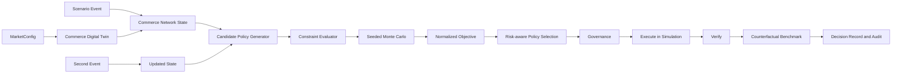

# ARCI Decision Engine

> V4 keeps the V3 server-isolated Hybrid LLM boundary and streams the deterministic decision before the asynchronous explanation without changing decision authority. See [ARCI_HYBRID_INTELLIGENCE.md](./ARCI_HYBRID_INTELLIGENCE.md).

ARCI Enterprise Intelligence V2 is a frontend-contained, deterministic commerce-resilience prototype. It is not a Sea, Shopee, or SPX production system and does not use proprietary operational data. Taiwan is the first demonstration market; the decision engine accepts a generic `MarketConfig` and is also exercised against a three-node synthetic market.

## Architecture



The public boundaries are `createCommerceDigitalTwin(market, events, seed)` and `evaluateScenario(scenario, market, options)`. React components consume the exported result/config contract rather than candidate, constraint, Monte Carlo, or selection internals. `simulation/enterpriseAdapter.ts` projects one `ScenarioEvaluation` into the protected demo snapshot and route interfaces.

## 1. Commerce Digital Twin

`MarketConfig` contains fulfillment nodes, operational corridors, SLA policy, carrier modes, geographic constraints, and default objective weights. Node state includes inventory, backlog, processing capacity, inbound/outbound rate, service level, weather/traffic exposure, carrier availability, and current risks. Edge state includes mode, transit time, capacity, disruption probability, congestion, weather sensitivity, cost, and availability.

Taiwan has seven operational nodes in the engine: three mainland nodes plus Penghu, Kinmen, Matsu, and Green Island. Each offshore node must have a feasible air or sea edge; the Taitung gateway remains a visual route helper and is not an eighth operational node. `CommerceDigitalTwin` records the initial and current state plus one stable state-snapshot ID.

## 2. State and event model

The implemented state corresponds to:

```text
s_t = { demand, inventory, capacity, backlog, weather, traffic,
        carrier availability, SLA state, nodes, edges }
```

Events modify state variables rather than assigning outcomes:

- `DEMAND_SURGE` changes the network demand multiplier.
- `TRAFFIC_DISRUPTION` reduces affected road-edge capacity and increases disruption risk.
- `WEATHER_DISRUPTION` reduces exposed node/edge capacity and raises weather risk.
- `CARRIER_CAPACITY` changes air/sea/road availability.
- `NODE_FAILURE` reduces node and connected-edge capacity.
- `RECOVERY` restores bounded capacity and lowers risks.

All ratios are clamped and every division uses `safeDivide`.

## 3. Action space and candidate generation

The candidate generator returns seven policies per evaluation, within the configured 5–20 limit. A policy may contain typed actions:

```text
KEEP_CURRENT_POLICY
REROUTE
INVENTORY_REBALANCE
CARRIER_MODE_SWITCH
CAPACITY_RESERVATION
ORDER_PRIORITIZATION
TEMPORARY_HOLD
```

Candidate volume is derived from current demand, physical spare capacity, the highest-load node, and SLA pressure. Main nodes, offshore nodes, and corridors are selected from `MarketConfig`; candidate generation contains no Taiwan node or edge IDs. A reroute conserves flow: transferred volume is removed from the highest-load source and added to explicit destination allocations.

## 4. Hard constraints

`evaluateConstraints` returns `{ feasible, violations, capacityMargin }`. Infeasible candidates never enter selection. Implemented hard constraints are:

```text
allocation(node) + nodeDemand <= availableNodeCapacity
capacityReservation <= physical spare capacity
inventoryTransfer <= availableInventory
sum(destinationAllocation) = reroutedFlow
requiredCorridorCapacity >= requiredFlow
offshoreNode has at least one available air or sea edge
servedNodes contains every required operational node
temporaryHold preserves the configured service requirement
Monte Carlo aggregate serviceLevel >= configured minimum service level
```

`CAPACITY_RESERVATION` earmarks existing throughput and reduces throughput variance; it never adds nominal processing capacity. Violations use machine-readable codes such as `CAPACITY_CONSTRAINT`, `INVENTORY_CONSTRAINT`, `FLOW_CONSERVATION`, `ROUTE_UNAVAILABLE`, `ISLAND_CONNECTIVITY_RISK`, `MINIMUM_SERVICE_REQUIREMENT`, and `OPERATIONAL_NODE_COVERAGE`.

## 5. Objective and normalization

Each candidate simulation produces six loss components in `[0,1]`:

```text
L_sla         = clamp((1 - serviceLevel) / (1 - minimumSLA + 0.15))
L_cost        = clamp(operationalCost / 28)
L_risk        = clamp(0.62 * P90Delay / maximumDelay
                      + 0.38 * slaBreaches / 80)
L_recovery    = clamp(recoveryMinutes / 150)
L_capacity    = clamp(overloadMinutes / 150)
L_instability = clamp(switchingMagnitude / 0.35)
```

The expected objective implemented in `objective.ts` is:

```text
J(a | s_t) = sum_k w_k(s_t) * L_k(a, s_t)
```

The risk-aware selection value implemented in `monteCarlo.ts` is:

```text
RiskAdjustedScore = mean(J) + 0.24 * P90(J)
```

Lower is better. Cost, delay, probabilities, recovery time, capacity stress, and instability are never added before normalization.

## 6. Adaptive weights

Weights start from `MarketConfig.objectiveDefaults`. State-derived additions raise SLA, risk, recovery, or capacity priority as SLA pressure, weather, traffic, island risk, or node stress rises. Cost priority decreases during disruption; stability priority rises in no-event operation. The raw values are divided by their sum and the floating residual is assigned to `slaLoss`, so:

```text
0 <= w_k <= 1
sum_k w_k = 1
```

The mechanism is deterministic and inspectable in `deriveAdaptiveWeights`.

## 7. Monte Carlo uncertainty

The default evaluation uses 240 samples. `generateDisturbances(seed, count)` uses a seeded xorshift generator; `Math.random` is not used. Every candidate in one scenario receives the same ordered disturbance set, covering demand, transit, weather, traffic, carrier capacity, and throughput.

Each candidate reports mean, P50, P90, best case, worst case, and probability of an SLA breach. Decision confidence is computed as:

```text
confidence = 0.45 * selectionConsistency
           + 0.30 * normalizedScoreGap
           + 0.25 * constraintStability
```

It is not an arbitrary display percentage.

## 8. Counterfactual benchmark

Static/no intervention, a state-driven fixed rule-based fallback, and ARCI share the exact `stateSnapshotId`, event sequence, seed, and Monte Carlo disturbances. The fixed rule policy does not depend on the ARCI winner. The result records `baselinePolicyId`, `ruleBasedPolicyId`, and `arciPolicyId` alongside SLA breaches, mean delay, P90 delay, recovery time, cost index, capacity-overload minutes, service level, and unfulfilled orders.

For lower-is-better metrics:

```text
delta = baseline - arci
percentageImprovement = delta / abs(baseline)
```

For service level, the sign is reversed. A zero baseline produces `null`, not a fabricated percentage. The simulator is allowed to show a small, zero, or negative improvement.

## 9. Governance and rollback

Governance states are `AUTONOMOUS`, `APPROVAL_REQUIRED`, and `BLOCKED`. Prototype thresholds are centralized in `DECISION_ENGINE_PARAMETERS`:

- cost increase above 8% requires approval;
- reallocation above 25% requires approval;
- a hard-constraint violation is blocked;
- material service, capacity, or normalized-risk deterioration against the previous decision makes rollback eligible/triggered.

These are prototype configuration values, not Sea corporate policy.

## 10. Decision record and audit trail

Each run creates a deterministic `DecisionRecord` containing state ID, candidates, rejected policies, weights, selected policy, objective breakdown, uncertainty, reason codes, the top three state-derived decision factors, prior policy, and trigger. Audit stages cover Observe, Detect, Evaluate, Decide, Act, Verify, Counterfactual, and Replan when applicable.

Reason codes are generated from state, constraints, and computed outcomes; natural-language copy only formats those results.

## 11. Second-event replanning

The second event applies `NODE_FAILURE` to the current network state. `evaluateScenario` then rebuilds the state snapshot, regenerates candidates, reruns all hard constraints, reuses the scenario seed for a new common disturbance set, re-evaluates objective/tail risk, selects again, performs governance, and records `SECOND_EVENT_REPLAN`. Tests require a new state ID, decision ID, selected policy, and `REPLAN` audit entry.

## 12. Regional-ready configuration

`markets/taiwan.ts` is one `MarketConfig`; `markets/synthetic.ts` is a three-node fixture with an offshore node. The same engine, market-derived candidates, constraints, Monte Carlo, counterfactual, and governance code runs against both. Tests reject any candidate that references a node or edge outside the synthetic market. No Southeast Asia map or unverified market data is implied.

## Parameter provenance

| Category | Classification | Notes |
|---|---|---|
| Taiwan mainland/offshore membership and protected geometry | Public/geographic project baseline | Geometry remains isolated in `simulation/geography.ts`. |
| Node inventory, backlog, throughput, capacity, carrier availability | `SIMULATION_ASSUMPTION` | Synthetic prototype parameters, not Shopee/Sea/SPX data. |
| Edge transit, capacity, cost, disruption sensitivity | `SIMULATION_ASSUMPTION` | Used only to exercise the decision architecture. |
| Event impacts, candidate shares, state transitions | `SIMULATION_ASSUMPTION` | Centralized in `DECISION_ENGINE_PARAMETERS`. |
| Simulation coefficients and normalization scales | `SIMULATION_ASSUMPTION` | Centralized in `DECISION_ENGINE_PARAMETERS`; formulas above use the same values. |
| Monte Carlo ranges and governance/rollback thresholds | `SIMULATION_ASSUMPTION` | Centralized in `DECISION_ENGINE_PARAMETERS`. |
| Objective, P50/P90, metrics, confidence, counterfactual deltas | `ARCI_DERIVED` | Reproducible outputs of the declared model and seed. |

## Legacy hard-coded audit

- `simulation/scenario.ts` still contains protected narrative/timeline fixture values used to preserve the 11-stage animation and geography regression baselines. `projectEngineSnapshot` replaces order rate, operational metrics, node state, event impact, active route, and reasoning before either page or provider displays them.
- The former `primaryCandidates` and `replanCandidates` hard-coded tables were removed. Production and tests now consume the same V2 candidate output.
- `domain/policy/scenarios.ts` remains a compatibility regression fixture for the original adaptive-policy unit tests. The two pages, map, runtime, and data provider no longer consume it for decisions.
- `simulation/runtime.ts` now delegates to the V2 decision engine adapter rather than returning prewritten candidates.
- Unknown operational values are centralized under market/config assumptions and are visibly labeled. No live or proprietary integration is claimed.
